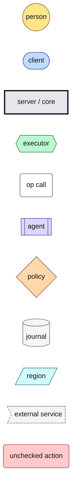
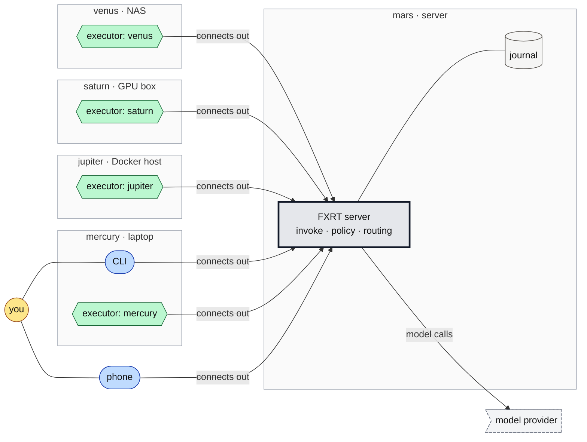
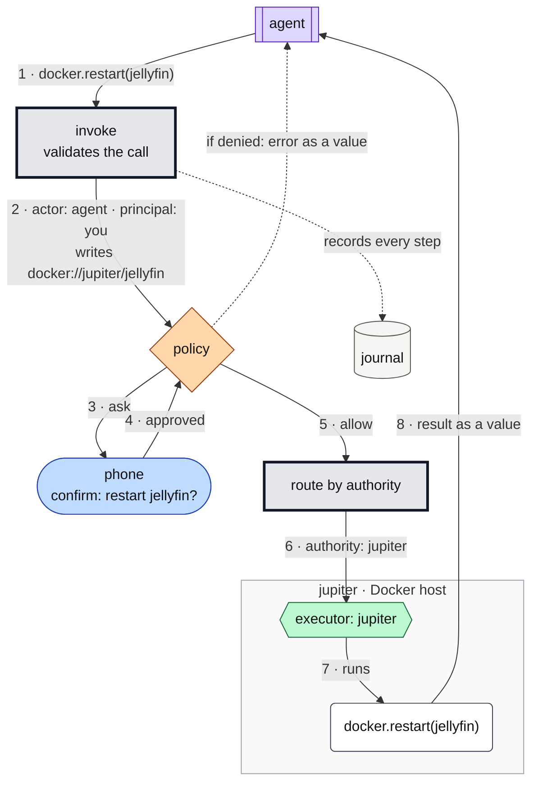
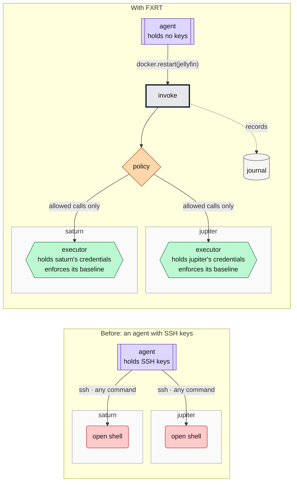
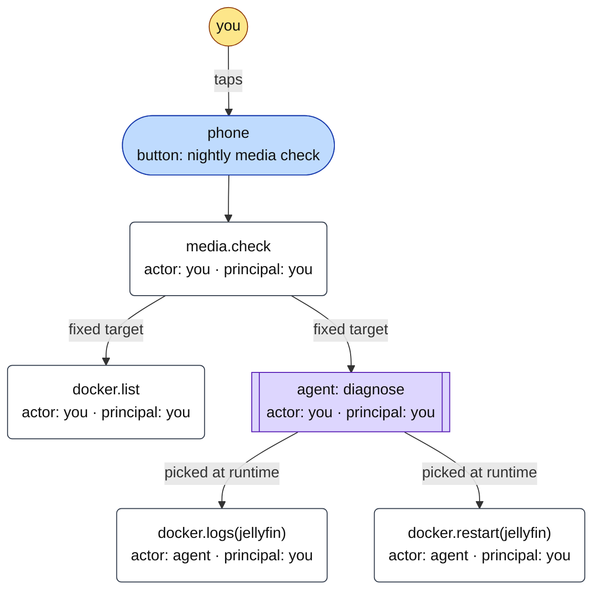
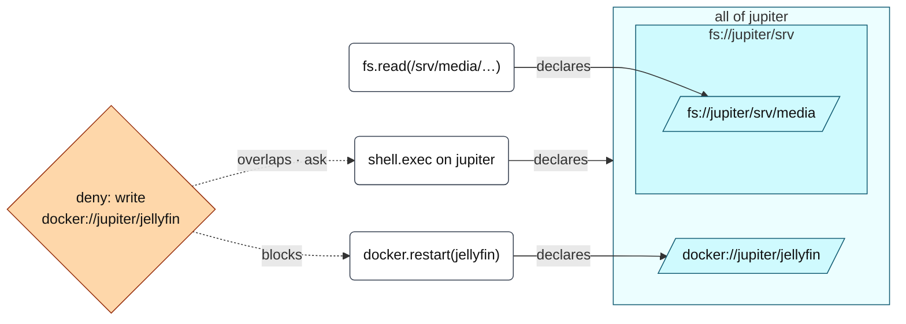
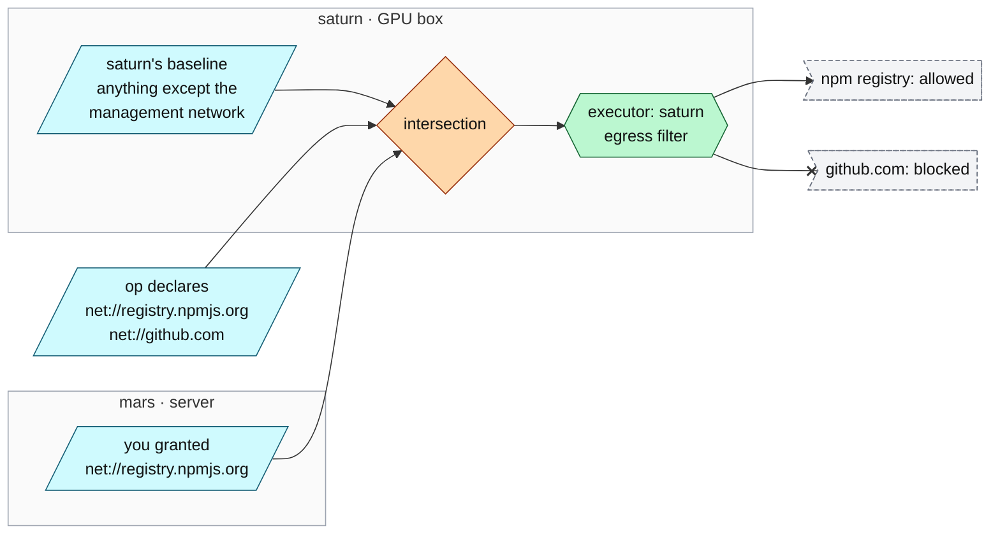

# Diagrams

Six diagrams of the FXRT model. They use the terms defined in design.md and share the conventions below, so a shape or a name means the same thing in every diagram.

## Conventions

**Shapes**

| Shape | Concept |
|---|---|
| Circle | A person (the principal in these examples) |
| Stadium (pill) | A client: the CLI, a phone |
| Rectangle, bold border | The server and its core: `invoke`, routing |
| Hexagon | An executor |
| Rounded rectangle | A call to an op |
| Double-edged rectangle | An agent |
| Diamond | A policy decision |
| Cylinder | The journal |
| Parallelogram | A region |
| Flag | An external service |
| Red rounded rectangle | An unchecked action (only in the "before" picture) |
| Grey box | A machine; a box inside a region box is a region inside a region |

**Placeholder names**

| Name | Role |
|---|---|
| you | The person using the system |
| mercury | Your laptop: runs the CLI, which is a client and an executor |
| mars | The machine that runs the FXRT server |
| jupiter | A Docker host, running the `jellyfin` container and media under `/srv/media` |
| saturn | A GPU box, used for builds and tests |
| venus | A NAS, used for backups |
| phone | A second interactive client |

Region names use the current `fs://`, `docker://` and `net://` schemes. "All of jupiter" stands for every region whose authority is jupiter; its syntax is not decided.

## 1. Topology

One server, executors on every machine, and clients wherever you are. Every executor and client opens its own connection out to the server, so no machine needs an open inbound port, and machines on different networks can join over a private network such as a tailnet. The CLI on mercury is one process in two roles: a client you type into, and an executor for mercury's files and shell.

## 2. The life of one call

The agent decides Jellyfin needs a restart. The call goes through `invoke` like every other call: the core validates it, and policy decides on it using who chose it (the agent), whose authority it uses (you) and the region it writes. A write chosen by an agent gets an ask, so you approve it on your phone. The call is then routed by its region's authority to jupiter's executor, and the result comes back to the agent as a value. The journal records every step. A denial would also come back as a value: an error the agent can read.

## 3. Before and after

On the left is the usual setup today: the agent holds SSH keys and runs open shells, so any command on any host is possible, and nothing between the agent and the machine checks or records it. On the right, the agent holds no keys. It makes typed calls, policy checks each one, and the journal records them. Each executor holds its own host's credentials and enforces a local baseline, so even the server can't make a host do what its baseline forbids.

## 4. Actor and principal

You tap a "nightly media check" button on your phone. It runs `media.check`, a fixed composition, so you are the actor for every call whose target was fixed in advance, including the call that starts the diagnosing agent. The agent then picks its own targets at runtime, so it becomes the actor for the calls it makes. The principal stays "you" through the whole tree: everything runs on your authority. Policy uses the actor to decide how strictly to check, and the principal to decide what is allowed at all.

## 5. Regions

Every op declares the regions it may read or write, and regions nest. `fs.read` touches one folder, and `docker.restart` touches one container. `shell.exec` can do anything on jupiter, so it declares all of jupiter, which contains both. Because policy compares regions, a deny on the Jellyfin container also catches `shell.exec`: its region overlaps the denied one, so the call is asked about rather than allowed. The narrower the op, the less it needs to ask.

## 6. Network rules in three layers

A build on saturn runs `npm install`. The network the call may reach is the intersection of three layers: what the op declares, what you have granted, and saturn's own baseline. The executor computes it and enforces it with an egress filter, so the npm registry is reachable and github.com, declared but never granted, is blocked. Grants live on the server and you can change them. The baseline lives on saturn, and the server can't widen it, so a compromised server still can't open what the host forbids.

